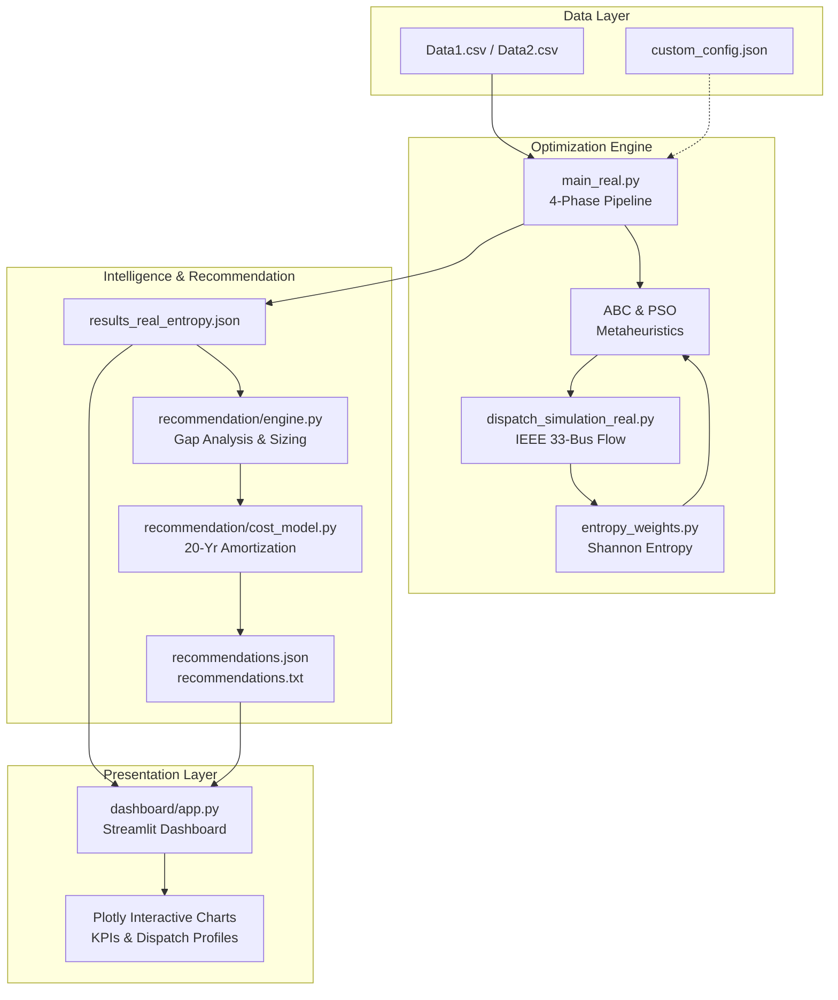

# Product Requirements Document (PRD): EcoGridAI Optimization Platform

**Project**: Microgrid Resource Optimizer & Resilience Benchmark Suite  
**Stack**: Python 3.11+, Streamlit, Plotly, NumPy, Pandas, IEEE 33-Bus System  
**Version**: 1.0.0  
**Status**: Completed  

---

## 1. Executive Summary & Product Vision

EcoGridAI is an enterprise-grade microgrid resource sizing and 24-hour dispatch resilience optimization platform. The system leverages metaheuristic optimizers—**Artificial Bee Colony (ABC)** and **Particle Swarm Optimization (PSO)**—to optimize distributed energy resource allocations (Solar PV, Wind, Battery Energy Storage, and Grid interconnection) across an IEEE 33-bus transmission network.

This document outlines the **2-Day Implementation Checklist** using the **RALPH Loop** methodology, implementing:
1. **Interactive Streamlit Dashboard** (`dashboard/app.py`): Real-time KPI analytics, multi-scenario comparative visualizers, dispatch profiles, and export features.
2. **Custom Data Input & Validation Engine** (`Resource_optimizer_real/data_input/`): Dynamic parameter input for IEEE 33-bus generation ratings and 24-hour load profiles.
3. **Autonomous Capacity Recommendation Engine** (`Resource_optimizer_real/recommendation/`): Deficit gap analysis, PV/Battery/Grid headroom expansion recommendations, and 20-year amortized financial modeling.

---

## 2. Architecture & Data Flow



---

## 3. 2-Day Implementation Checklist

### DAY 1 — Dashboard + Custom Data Input

#### TASK 1: Streamlit Dashboard
**Target Directory**: `dashboard/`  
**Core Technologies**: `streamlit`, `plotly`, `pandas`

- [x] **Step 1 — Setup**
  - [x] Install dependencies: `pip install plotly` (Streamlit confirmed available)
  - [x] Create directory `dashboard/`
  - [x] Create `dashboard/__init__.py`
  - [x] Create `dashboard/app.py`
  - [x] Verify `results_real.json` and `results_real_entropy.json` exist and are readable

- [x] **Step 2 — App Skeleton & Theme**
  - [x] Configure page: `st.set_page_config(page_title="EcoGridAI Dashboard", layout="wide")`
  - [x] Implement sleek dark theme styling (`#0F172A` canvas, `#1E293B` containers, `#10B981` ABC Green, `#0288D1` PSO Blue)
  - [x] Header bar with title, subtitle, and system status indicator
  - [x] Sidebar: Pipeline switcher (`Baseline (Equal Weights)` vs. `Shannon Entropy Weights`)
  - [x] Sidebar: Scenario selector dropdown (10 resilience scenarios)

- [x] **Step 3 — Data Service Layer**
  - [x] Create `dashboard/data_service.py`
  - [x] Implement `load_results(pipeline_mode)`:
    - If `baseline` $\rightarrow$ reads `results_real.json`
    - If `entropy` $\rightarrow$ reads `results_real_entropy.json`
  - [x] Extract scenario metadata, ABC metrics, and PSO metrics into structured dictionaries

- [x] **Step 4 — Metric KPI Cards Row**
  - [x] Create 5 side-by-side KPI metric cards for selected scenario:
    1. **Best Fitness Score ($F$)**
    2. **Total Daily Cost ($₹$)**
    3. **Load Satisfaction Rate ($\%$)**
    4. **Renewable Utilization ($\%$)**
    5. **Convergence Speed (Iterations to 95%)**
  - [x] Display ABC vs. PSO values with comparative delta badges (green = positive / lower cost / higher reliability)

- [x] **Step 5 — 10-Scenario Fitness Benchmark Chart**
  - [x] Interactive Plotly grouped bar chart: X = Scenario Names, Y = Fitness Score
  - [x] Double bars per scenario: ABC (Green `#10B981`) and PSO (Blue `#0288D1`)
  - [x] Hover tooltips showing exact numerical values, cost, and delta

- [x] **Step 6 — 24-Hour Energy Dispatch Profile Chart**
  - [x] Interactive Plotly stacked area chart: X = Hours 1–24, Y = Power (kW)
  - [x] Generation layers: Solar PV1 (Gold), Solar PV2 (Amber), Wind (Cyan), Battery Discharge (Purple), Grid Import (Orange)
  - [x] Superimposed high-contrast dashed line: Load Demand Curve
  - [x] Highlights unmet deficit zones when demand exceeds generation

- [x] **Step 7 — Metaheuristic Convergence Curves**
  - [x] Line plot: X = Iteration (1–100), Y = Best Fitness Scalar
  - [x] Dual traces: ABC Convergence curve vs. PSO Convergence curve
  - [x] Dynamic iteration marker displaying 95% threshold point

- [x] **Step 8 — Cost Breakdown Stacked Bar Chart**
  - [x] Stacked horizontal/vertical bar chart: Capital Cost vs. Operational Cost in ₹/day
  - [x] Grouped comparison: ABC vs. PSO for the active scenario

- [x] **Step 9 — Head-to-Head Comparison Table**
  - [x] Interactive table featuring: Metric Name | ABC Value | PSO Value | Delta | Winner Badge
  - [x] Auto-highlight winner column with badge pill

- [x] **Step 10 — Reactive Switcher Callbacks**
  - [x] Seamless state reactivity: Changing pipeline or scenario instantly recalculates and re-renders all charts without full reload

- [x] **Step 11 — Export Functionality**
  - [x] "Export CSV" button generating instant downloadable scenario benchmark data
  - [x] Plotly interactive toolbar for high-resolution SVG/PNG image export

- [x] **Step 12 — Final Polish & Testing**
  - [x] Responsive design across desktop displays ($\ge 1280 \times 720$)
  - [x] Loading spinners during asynchronous updates
  - [x] Full smoke test verifying all 10 scenarios render without exceptions

---

#### TASK 2: Custom Data Input + Validation
**Target Directory**: `Resource_optimizer_real/data_input/`

- [x] **Step 1 — Setup**
  - [x] Create directory `Resource_optimizer_real/data_input/`
  - [x] Create `Resource_optimizer_real/data_input/__init__.py`
  - [x] Create `Resource_optimizer_real/data_input/validator.py`
  - [x] Create `Resource_optimizer_real/data_input/input_form.py`

- [x] **Step 2 — Bus Rating Input Form**
  - [x] Function: `get_bus_ratings_from_user()` / UI Form
  - [x] Fields:
    - Number of PV sources (integer, 1–10)
    - Per PV: Bus assignment (1–33), Nameplate Rating kW (0–5,000 kW)
    - Number of Wind sources (integer, 1–5)
    - Per Wind: Bus assignment (1–33), Nameplate Rating kW (0–5,000 kW)
  - [x] Structured dictionary output: `[{"type": str, "bus": int, "rating_kw": float}]`

- [x] **Step 3 — Load Profile Input & Synthesis**
  - [x] Dual input modality:
    - Option A: Upload/Specify path to CSV file
    - Option B: Enter Peak Load (kW) $\rightarrow$ auto-synthesize 24-hour diurnal profile
  - [x] Profile preview table & terminal ASCII chart

- [x] **Step 4 — Rigorous Validator Module (`validator.py`)**
  - [x] `validate_bus_ratings(ratings)`:
    - Verify bus index $\in [1, 33]$
    - Verify rating $> 0$ and $\le 10,000$ kW
    - Enforce zero duplicate bus allocations
    - Return `{valid: bool, errors: list, warnings: list}`
  - [x] `validate_load_profile(profile)`:
    - Verify exactly 24 hourly data points
    - All hourly values $> 0$
    - Peak load $> 100$ kW
  - [x] `validate_csv_columns(df)`:
    - Verify mandatory column headers and non-null values

- [x] **Step 5 — Error Taxonomy & User Guidance**
  - [x] Clean error logs highlighting field name and violation rationale:
    - `[ERROR] Bus number 35 is out of range (valid: 1-33)`
    - `[ERROR] Rating -50 kW is invalid (must be > 0)`
    - `[WARNING] Only 20 hourly rows found (expected 24)`
  - [x] Retry prompts with maximum 3 retry iterations

- [x] **Step 6 — Integration with `main_real.py`**
  - [x] Add global configuration toggle at top of `main_real.py`:
    ```python
    USE_CUSTOM_INPUT = False  # Set to True to engage custom configuration
    ```
  - [x] When `True`: loads ratings from `custom_config.json` and updates `bus_network.py`
  - [x] When `False`: seamlessly falls back to standard `Data1.csv`

- [x] **Step 7 — Configuration Persistence**
  - [x] Save validated parameters to `Resource_optimizer_real/custom_config.json`
  - [x] Print confirmation message with saved timestamp

---

### DAY 2 — Capacity Recommendation Engine

#### TASK 3: Capacity Recommendation Engine
**Target Directory**: `Resource_optimizer_real/recommendation/`

- [x] **Step 1 — Setup**
  - [x] Create directory `Resource_optimizer_real/recommendation/`
  - [x] Create `Resource_optimizer_real/recommendation/__init__.py`
  - [x] Create `Resource_optimizer_real/recommendation/engine.py`
  - [x] Create `Resource_optimizer_real/recommendation/cost_model.py`
  - [x] Automatically load results from `results_real_entropy.json`

- [x] **Step 2 — Deficit & Gap Analysis**
  - [x] Implement `analyze_load_gap(scenario_results)`:
    - Unmet energy: $\text{Unmet\_kWh} = \text{Total\_Load} \times (1 - \text{Load\_Sat}/100)$
    - Peak deficit: $\text{Peak\_Unmet\_kW} = \max_t(\text{Unmet\_Load}(t))$
    - Critical hours identification ($t_{\text{start}}$ to $t_{\text{end}}$)
  - [x] Test on baseline scenarios (e.g. Normal Operation 3,071 kWh deficit)

- [x] **Step 3 — Heuristic Sizing Logic**
  - [x] `recommend_pv(gap_kw, current_vector)`:
    - Evaluate available headroom at Bus 13: $851.5 \times (1 - x_0)$
    - Evaluate available headroom at Bus 30: $1157.6 \times (1 - x_1)$
    - If gap fits within existing buses $\rightarrow$ recommend sizing fraction increase
    - If gap exceeds ceiling $\rightarrow$ recommend supplementary PV at candidate bus
  - [x] `recommend_battery(scenario_data)`:
    - If grid outage load satisfaction $< 80\% \rightarrow$ recommend storage expansion
    - Required capacity: $E_{\text{req}} = \text{Unmet\_kWh} \times 1.20$ ($20\%$ safety margin)
    - Required inverter rating: $P_{\text{req}} = \text{Peak\_Unmet\_kW} \times 1.10$
  - [x] `recommend_grid(scenario_data)`:
    - If normal operation load satisfaction $< 98\% \rightarrow$ recommend grid limit upgrade
    - Required capacity: $\text{Peak\_Unmet\_kW} \times 1.10$

- [x] **Step 4 — 20-Year Financial Cost Estimation (`cost_model.py`)**
  - [x] Benchmark capital investment rates:
    - **Solar PV**: ₹50,000 / kW
    - **Wind Turbines**: ₹60,000 / kW
    - **Battery Energy Storage**: ₹15,000 / kWh
    - **Grid Interconnect Expansion**: ₹5,000 / kW
  - [x] Amortized daily cost calculation:
    $$\text{Daily Amortized Cost} = \frac{\text{Capital Cost}}{20 \text{ years} \times 365 \text{ days}} = \frac{\text{Capital Cost}}{7,300}$$

- [x] **Step 5 — Recommendation Report Generator**
  - [x] Implement `generate_report(all_scenarios)`
  - [x] Formatted executive report output with scenario breakdowns, recommended additions, and financial impact

- [x] **Step 6 — Multi-Criteria Priority Ranking**
  - [x] Calculate cost-effectiveness metric:
    $$\Phi = \frac{\text{Total Capital Cost}}{\text{Additional kW Served}}$$
  - [x] Sort ascending (most cost-effective interventions first)
  - [x] Categorize actions: `RECOMMENDED` ($\Phi \le 50k$), `ALTERNATIVE` ($50k < \Phi \le 80k$), `EXPENSIVE` ($\Phi > 80k$)

- [x] **Step 7 — Report Persistence**
  - [x] Export structured JSON: `Resource_optimizer_real/recommendations.json`
  - [x] Export human-readable ASCII report: `Resource_optimizer_real/recommendations.txt`

- [x] **Step 8 — Platform Integration**
  - [x] Hook into `main_real.py`: Automatically invoke `generate_report()` at conclusion of optimization runs
  - [x] Integrate into Streamlit Dashboard: Dedicated **"Capacity Recommendations"** tab featuring interactive scenario cards and financial summaries

---

## 4. Verification & Quality Gates

| Milestone | Acceptance Criteria |
| :--- | :--- |
| **Dashboard** | Streamlit app launches locally (`localhost:8501`), all 10 scenarios switch smoothly with zero console errors. |
| **Input Validation** | Validator correctly rejects invalid buses (e.g. 35), negative ratings, and invalid CSV headers with descriptive guidance. |
| **Custom Run** | `main_real.py` with `USE_CUSTOM_INPUT = True` consumes `custom_config.json` and overrides baseline bus capacities. |
| **Recommendations** | Deficit calculations match simulation unmet loads within 0.1 kWh; cost estimates amortize correctly across 7,300 days. |
| **End-to-End** | Optimizers run $\rightarrow$ results exported $\rightarrow$ recommendations generated $\rightarrow$ dashboard renders full pipeline live. |
