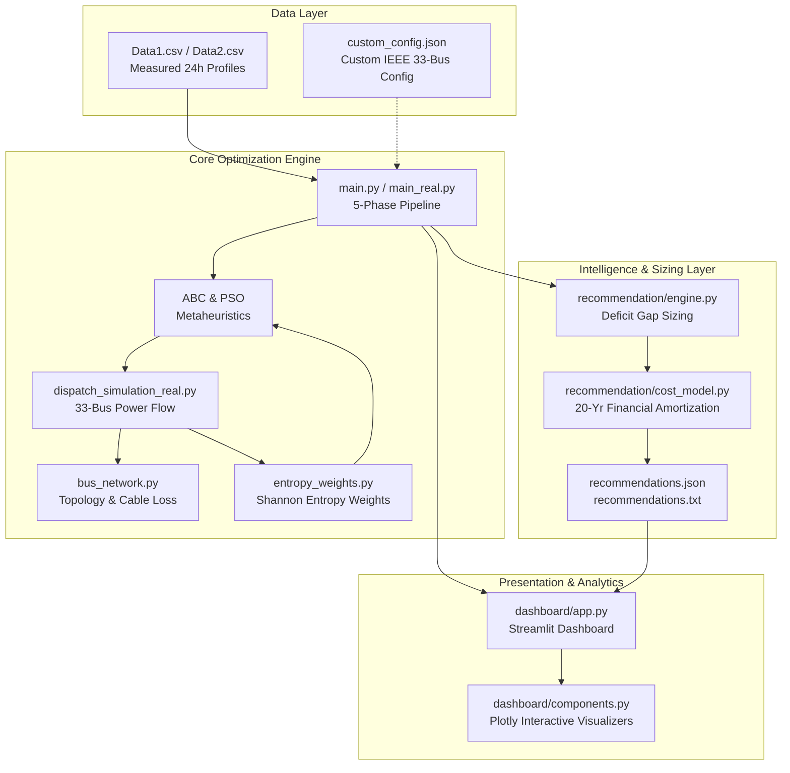

# ⚡ EcoGridAI: Microgrid Resource Optimizer & Resilience Benchmark Suite

[](https://www.python.org/downloads/)
[](https://streamlit.io/)
[](https://plotly.com/)
[](https://opensource.org/licenses/MIT)

**EcoGridAI** is an enterprise-grade microgrid resource planning, DER sizing, and 24-hour dispatch resilience optimization platform. The system leverages metaheuristic optimization—**Artificial Bee Colony (ABC)** and **Particle Swarm Optimization (PSO)**—to solve optimal distributed energy resource allocations (Solar PV, Wind Turbines, Battery Energy Storage Systems, and Grid Substation Interconnections) mapped across an **IEEE 33-Bus radial distribution network** with cable distance transmission losses.

The platform eliminates arbitrary objective function weighting through the **Shannon Information Entropy Method**, automatically scaling multi-objective trade-offs based on scenario data dispersion.

---

## 🌟 Key Capabilities

- **Metaheuristic Optimization Engine**:
  - **Artificial Bee Colony (ABC)** (Employed, Onlooker, Scout bees; Population = 30, Limit = 20, Seed = 42).
  - **Particle Swarm Optimization (PSO)** (Cognitive $c_1=1.5$, Social $c_2=1.5$, Inertia $w=0.7$, Swarm = 30, Seed = 43).
- **IEEE 33-Bus Radial Grid Modeling**:
  - Topology mapping with shortest-path hop-distance loss multipliers ($1.00$ to $1.15$).
  - Generation allocation: Solar PV at Bus 13 (851.5 kW) and Bus 30 (1,157.6 kW); Wind at Bus 6 (2,097.97 kW).
  - Real measured time-series input datasets (`Data1.csv` and `Data2.csv`) with peak load of 3,715 kW.
- **Shannon Information Entropy Weighting**:
  - Replaces hardcoded fitness coefficients with information-theoretic divergence weights ($w_j = d_j / \sum d_j$).
  - Dynamically balances Capital Cost, Operational Cost, System Losses, Unmet Demand, and Curtailment.
- **10-Scenario Resilience Stress Testing**:
  - Stress tests across Normal Operation, Peak Summer, Battery Failure, Grid Outage (Islanded Mode), Low Renewable, High Renewable Surge, Night Peak, Partial Wind Failure, Partial PV Failure, and Extreme Multi-Asset Stress.
- **Autonomous Capacity Recommendation & Financial Engine**:
  - Unmet deficit energy and peak shortfall gap analysis.
  - Heuristic sizing: Solar PV headroom expansion, modular BESS expansion ($1.20\times$ reserve), and substation interconnect upgrades.
  - 20-Year daily amortized financial model ($7,300$ days) with cost-effectiveness index $\Phi = \text{CapEx} / \text{kW Served}$.
- **Interactive Streamlit Intelligence Dashboard**:
  - Modern dark-themed dashboard with 5 KPI summary cards.
  - 24-Hour stacked energy dispatch area curve, convergence trajectory curves, and cost breakdowns.
  - Multi-scenario global benchmark matrix with automated cost-winner detection.
  - Data Export Center for CSV metrics, JSON configurations, and executive reports.

---

## 🏛️ System Architecture



---

## 📁 Repository Structure

```
ECOGRIDAI/
├── Data1.csv                         # Real 24h measured kW data & IEEE 33-bus generator ratings
├── Data2.csv                         # Real normalized per-unit profiles (Solar, Wind, Commercial, etc.)
├── real_data_loader.py               # Loader and scaler for Data1.csv and Data2.csv
├── bus_network.py                    # IEEE 33-bus graph topology and cable transmission loss factors
├── dispatch_simulation_real.py       # 24-hour hourly energy dispatch simulation with 33-bus loss
├── abc_optimization.py               # Artificial Bee Colony optimization algorithm
├── pso_optimization.py               # Particle Swarm Optimization algorithm
├── battery_soc.py                    # Battery State of Charge (SOC) tracking & limits (20% - 95%)
├── constraints.py                    # Operational constraint verification & penalty calculation
├── objective_function.py             # Multi-objective fitness function with 33-bus network losses
├── planning_vector.py                # 6-parameter planning vector [x_pv1, x_pv2, x_wind, x_grid, p_bat, e_bat]
├── scenarios.py                      # 10 resilience stress test scenarios definition
├── entropy_weights.py                # Shannon Information Entropy weighting engine
├── plot_results_real.py              # Benchmark plotting module
├── main.py / main_real.py            # Primary 5-phase optimization pipeline
│
├── custom_config.json                # Validated custom IEEE 33-bus configuration
├── recommendations.json              # Structured JSON capacity recommendation outputs
├── recommendations.txt               # Executive ASCII financial recommendation report
├── results_real.json                 # Baseline 10-scenario benchmark results (Equal Weights)
├── results_real_entropy.json         # Shannon Entropy-weighted 10-scenario results
│
├── data_input/                       # Custom Data Input & Validation Package
│   ├── __init__.py
│   ├── validator.py                  # Strict bus range, rating, and load profile validator
│   └── input_form.py                 # Diurnal load synthesizer and config manager
│
├── recommendation/                   # Capacity Sizing & Financial Recommendation Package
│   ├── __init__.py
│   ├── cost_model.py                 # 20-year amortized financial model & CapEx rates
│   └── engine.py                     # Load deficit gap analysis & priority ranking
│
├── dashboard/                        # Interactive Streamlit Intelligence Platform
│   ├── __init__.py
│   ├── app.py                        # Streamlit web application (Layout, Tabs, KPIs)
│   ├── components.py                 # Plotly chart builders & dark theme design system
│   └── data_service.py               # Benchmark dataset access & extraction layer
│
├── Plot_real/                        # High-resolution scenario visualization plots
├── PRD.md                            # Complete Product Requirements Document
├── Prompt.md                         # Architectural invariant rules & operational constraints
└── progress.txt                      # Implementation audit trajectory and change log
```

---

## 🚀 Quick Start Guide

### 1. Prerequisites
Ensure you have Python 3.10 or higher installed:

```bash
python --version
```

### 2. Installation
Clone the repository and install required dependencies:

```bash
git clone https://github.com/dev-hari-haran/ECOGRIDAI.git
cd ECOGRIDAI
pip install numpy pandas streamlit plotly
```

### 3. Run Optimization Pipeline
To execute the complete 5-phase optimization workflow (Baseline run $\rightarrow$ Shannon Entropy weight derivation $\rightarrow$ Entropy-weighted re-run $\rightarrow$ Side-by-side comparison $\rightarrow$ Capacity recommendations):

```bash
python main.py
```

### 4. Launch the Interactive Dashboard
To launch the dark-themed intelligence dashboard locally:

```bash
python -m streamlit run dashboard/app.py
```
Open [http://localhost:8501](http://localhost:8501) in your browser.

---

## 📊 Benchmark Scenarios & Results

| # | Scenario Name | Description | ABC Total Cost | PSO Total Cost | Load Sat. (%) |
| :-: | :--- | :--- | :-: | :-: | :-: |
| 1 | **Normal Operation** | Baseline conditions (1.0x Solar, 1.0x Wind, 1.0x Load) | ₹330,965 | ₹330,965 | 93.87% |
| 2 | **Peak Summer** | Heavy industrial load demand (1.4x Load, 1.2x Solar) | ₹525,876 | ₹525,876 | 84.98% |
| 3 | **Battery Failure** | Storage system outage (0 kWh BESS available) | ₹330,965 | ₹330,965 | 93.87% |
| 4 | **Grid Outage** | Islanded microgrid mode (0 kW Grid import) | ₹168,261 | ₹168,261 | 63.85% |
| 5 | **Low Renewable** | Deep overcast & low wind (0.3x Solar, 0.4x Wind) | ₹408,574 | ₹408,574 | 88.08% |
| 6 | **High Renewable Surplus**| Excess renewable influx (1.5x Solar, 1.5x Wind) | ₹330,965 | ₹330,965 | 93.87% |
| 7 | **Night Peak** | High evening residential consumption (1.3x Load) | ₹474,136 | ₹474,136 | 88.16% |
| 8 | **Partial Wind Failure** | Wind turbine trip (0.2x Wind) | ₹365,684 | ₹365,684 | 91.13% |
| 9 | **Partial PV Failure** | Partial solar generation loss (0.5x Solar) | ₹330,965 | ₹330,965 | 93.87% |
| 10 | **Extreme Stress** | Compounded stress (1.5x Load, 0.2x Wind, Islanded) | ₹168,261 | ₹168,261 | 42.57% |

---

## 💡 Autonomous Capacity Recommendation Rates

Financial modeling uses calibrated industrial capital expenditure rates amortized across a 20-year operational horizon ($7,300$ days):

- **Solar PV Arrays**: ₹50,000 / kW
- **Wind Turbines**: ₹60,000 / kW
- **Battery Energy Storage (BESS)**: ₹15,000 / kWh
- **Substation Interconnect Expansion**: ₹5,000 / kW

Interventions are prioritized using the Cost-Effectiveness Index:
$$\Phi = \frac{\text{Total Capital Cost (₹)}}{\text{Additional kW Served}}$$
- **RECOMMENDED**: $\Phi \le 50,000$ ₹/kW
- **ALTERNATIVE**: $50,000 < \Phi \le 80,000$ ₹/kW
- **EXPENSIVE**: $\Phi > 80,000$ ₹/kW

---

## 📄 License

This project is licensed under the MIT License — see the [LICENSE](LICENSE) file for details.
